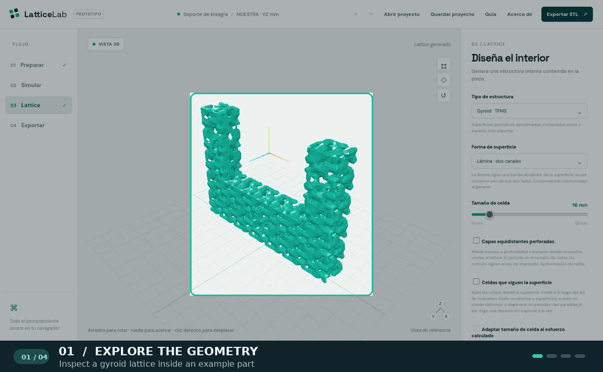

<div align="center">

# Lattice Lab

**Design lattice structures inside 3D parts, directly in your browser.**

Import a part · explore geometry · compare approximate responses · export a printable mesh

[](https://github.com/010zx00x1/lattice-lab/actions/workflows/ci.yml)
[](LICENSE)


[Quick start](#quick-start) · [Workflow](#from-part-to-mesh) · [Architecture](docs/ARCHITECTURE.md) · [Contribute](CONTRIBUTING.md)

</div>



<p align="center"><sub>An animated tour of the current editor interface, shown with the included hinge bracket example.</sub></p>

Lattice Lab is an independent, experimental CAD workflow for importing a part, generating an internal lattice, exploring approximate structural and thermal responses, and exporting a printable mesh. Part geometry is processed locally in the browser. It is not affiliated with IMPLICIT.

> **Project status:** Active prototype. Analysis and manufacturing checks are exploratory, not engineering certification. See the [feature parity and validation checklist](PARITY.md) for verified capabilities and remaining work.

## From part to mesh

| 01 · Prepare | 02 · Design | 03 · Explore | 04 · Export |
| --- | --- | --- | --- |
| Open one of six examples or import STL, STEP, or 3MF. Inspect and repair basic mesh defects. | Choose a TPMS, beam, or approximate stochastic pattern. Tune cells, walls, skins, and local zones. | Review approximate elastic, thermal, and channel responses, plus connectivity and printability indicators. | Validate the generated mesh and download STL or 3MF for further inspection. |

## Highlights

| Area | What you can do |
| --- | --- |
| Start with a part | Import STL, STEP, or 3MF; inspect and repair basic mesh defects; manage bodies and CAD face regions. Six built-in examples include four original mechanical parts. |
| Design a lattice | Generate eight TPMS families, five periodic beam families, and approximate stochastic structures. Add skins, local wall zones, solid support regions, and stress-guided grading. |
| Explore performance | Run approximate elastic, thermal, and channel-connectivity analyses; compare candidates by relative density or axial stiffness. |
| Check and export | Inspect connectivity, sampled wall thickness, overhangs, and build volume; export validated geometry as STL or 3MF. |
| Save your work | Download and reopen a local project containing the source geometry and design settings. |

Dense results use a lightweight point preview by default. The complete mesh remains available for analysis and export, and the view can be switched back to it.

## Quick start

Requires Node.js `^20.19.0 || >=22.12.0` and pnpm `11.25.0`. The recommended Node major version is in `.nvmrc`.

```bash
pnpm install --frozen-lockfile
pnpm dev
```

Open the local URL printed by Vite. No account or application server is required. To verify a checkout and produce a static build:

```bash
pnpm test
pnpm build
```

GitHub Actions runs the same checks on pushes and pull requests.

## Try it

1. Open one of the included mechanical examples, or import a closed STL, STEP, or 3MF part.
2. Review the mesh and, if useful, select faces for supports, loads, solid regions, or skin openings.
3. Choose a lattice family and adjust the cell size, wall thickness, skin, and local zones.
4. Generate the lattice, review the geometry and manufacturing indicators, then export STL or 3MF.

The **Guide** button in the editor walks through the main workflow. Files remain in your browser unless you explicitly download a project or export.

## Documentation

- [Features and technical limits](docs/FEATURES.md) — geometry, simulation, manufacturing checks, project files, and their assumptions.
- [Architecture](docs/ARCHITECTURE.md) — browser data flow, workers, source layout, and build output.
- [Validation and parity checklist](PARITY.md) — tested behavior and work still needed before claiming broader equivalence.
- [Contributing](CONTRIBUTING.md) — how to report a reproducible issue and run checks locally.

## Repository layout

```text
src/             Editor, geometry, simulation, and browser workers
tests/           Geometry, solver, serialization, and project tests
scripts/         Reproducible calibration of the objective library
public/cad/      Unmodified STEP converter runtime and license notices
docs/            Feature details, architecture, and screenshots
.github/         CI and issue templates
```

`dist/`, `node_modules/`, and local `.env` files are excluded from Git.

## Current limits

- Input is limited to 25 MB and 80,000 triangles. Dense outputs can take tens of seconds to generate or export.
- Structural and thermal solvers use coarse voxel models; channel analysis is a connectivity and conductance estimate, not CFD.
- Wall thickness and overhang checks use sampling and geometric heuristics. Inspect exported parts in manufacturing software before production.
- Some lattice families and spatial layouts are approximations. See the [detailed limits](docs/FEATURES.md) and [parity checklist](PARITY.md).

## Dependencies and license

The bundled STEP converter files in `public/cad/` match `occt-import-js@0.0.23` byte for byte. Its and OCCT's LGPL notices are included beside the files; other JavaScript dependencies are installed from npm.

The original Lattice Lab code is available under the [MIT License](LICENSE), copyright 2026 `010zx00x1`. Third-party components retain their own licenses and notices. `private: true` in `package.json` prevents accidental publication to npm; it does not change the repository license.
