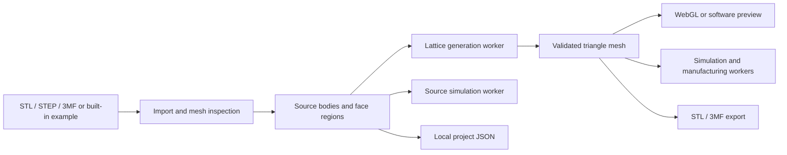

# Architecture

Lattice Lab is a static Vite application. Its geometry, project data, and analysis jobs run in the user's browser; there is no application backend or account service. The editor coordinates jobs in `src/main.js`, while expensive operations use Web Workers so the interface can show progress and cancel work.

## Main modules

| Path | Responsibility |
| --- | --- |
| `src/main.js` | UI state, Three.js scene, file import/export, worker lifecycle, progress, and cancellation. |
| `src/mesh-inspect-worker.js`, `src/mesh-quality.js` | Check and repair input and generated triangle meshes. |
| `public/cad/step-worker.js`, `public/cad/occt-import-js.*` | Convert STEP with an unmodified OCCT-based runtime. |
| `src/source-bodies.js`, `src/face-groups.js`, `src/face-sets.js` | Preserve visible bodies and selectable CAD or angle-derived face regions. |
| `src/lattice-worker.js`, `src/tpms.js`, `src/spatial-layout.js` | Sample the implicit field, apply spatial controls, triangulate, and validate the lattice. |
| `src/simulation-worker.js`, `src/voxelize.js`, `src/*-solver.js` | Coarse voxel models for elastic, thermal, and channel analyses. |
| `src/optimization-worker.js`, `src/objective-library.js`, `src/library-data.json` | Parametric search and an offline-calibrated catalog of periodic cells. |
| `src/thickness-worker.js`, `src/overhang-worker.js` | Sample final wall thickness and report downward-facing surface area. |
| `src/project.js`, `src/three-mf.js` | Local project serialization and 3MF export. |

## Geometry path

STL and 3MF are read by Three.js loaders; STEP is converted by the bundled `occt-import-js` worker. The inspection worker orients and checks triangles, removes degenerate faces, and can close small, flat, convex holes. A source must have a closed, nonzero volume before lattice generation. STEP face ranges are retained when repair leaves the triangle count unchanged; other input uses angle-based face grouping.

The lattice worker samples the chosen periodic or stochastic field within the source mesh. It combines the field with optional exterior skin, face openings, local thickness zones, stress grading, solid support regions, and spatial layouts. The result is triangulated, cleaned, and checked for boundary and non-manifold edges. Material connectivity is estimated on the sampling grid. A successful worker result transfers the full triangle buffer back to the editor.

For WebGL results above 250,000 triangles, the editor initially renders up to 80,000 shaded points. The complete triangle mesh remains in memory for analysis and export; users can switch the view to it. Without WebGL, a Canvas 2D fallback samples the surface and reduces detail while the model is being dragged.

## Analysis path

The simulation worker voxelizes the source or generated mesh. The structural solver uses linear isotropic hexahedral elements; the thermal solver uses a finite-volume conduction model; the channel analysis solves a normalized pressure network. These are exploratory models with coarse spatial resolution. The optimization worker searches a bounded set of cell size and wall settings using the same approximate field and structural model.

Manufacturing checks run after generation. They report sampled wall thickness, a geometric overhang estimate, and fit within the selected machine's nominal build volume. These checks do not certify printability. See [Features and technical limits](FEATURES.md) for assumptions and thresholds.

## Build and data

`pnpm build` produces a static `dist/` directory. Runtime dependencies and the STEP converter are included in the build or copied from `public/`. The Git-tracked `pnpm-lock.yaml` fixes dependency resolution. The calibration script `scripts/calibrate-library.mjs` can regenerate the periodic-cell data used by the objective library; it is not needed for ordinary builds.

The Sites deployment uses a local `.openai/hosting.json` with its project identifier. That file is excluded from the public source export; provide your own deployment configuration when hosting elsewhere.

Project files are downloaded JSON containing the source geometry and user settings. They are read and validated locally when reopened. The application does not upload or autosave parts.
